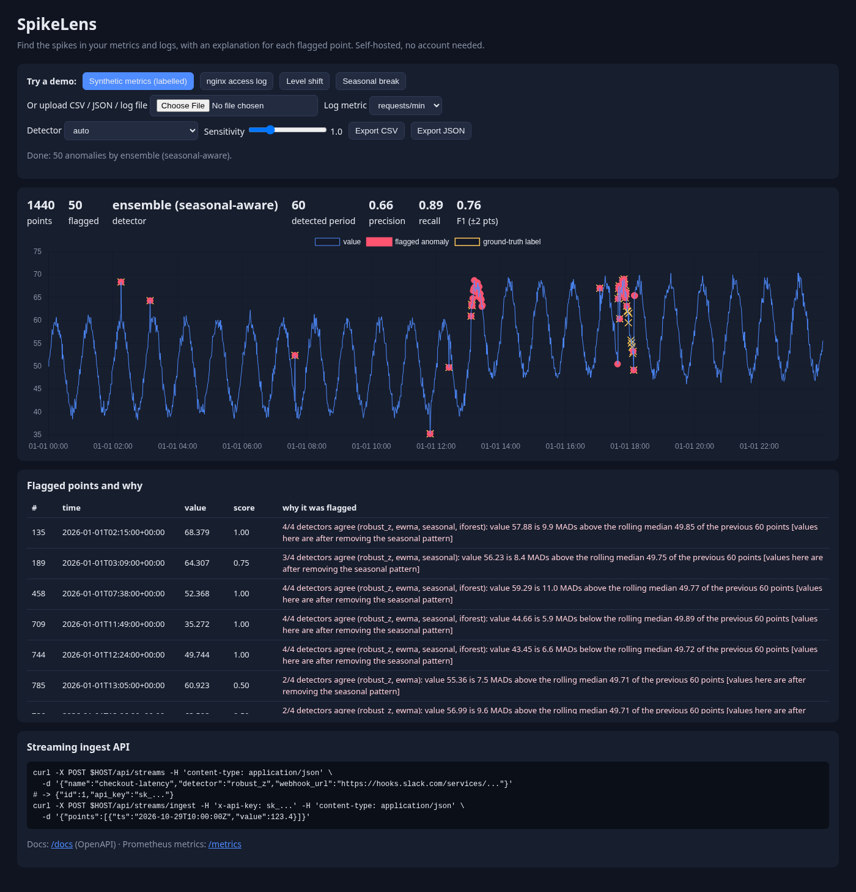
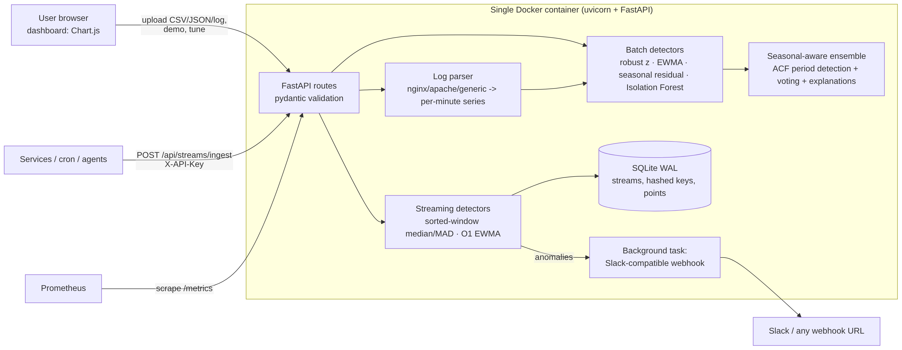
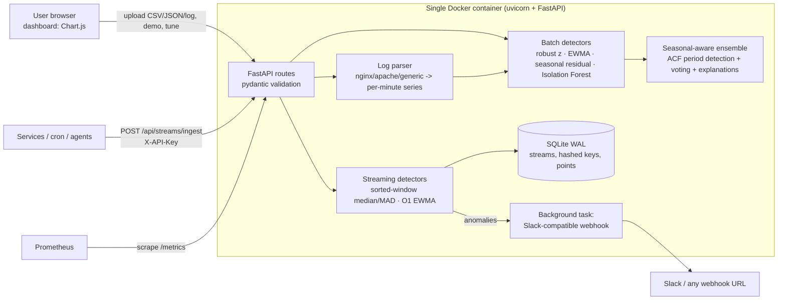
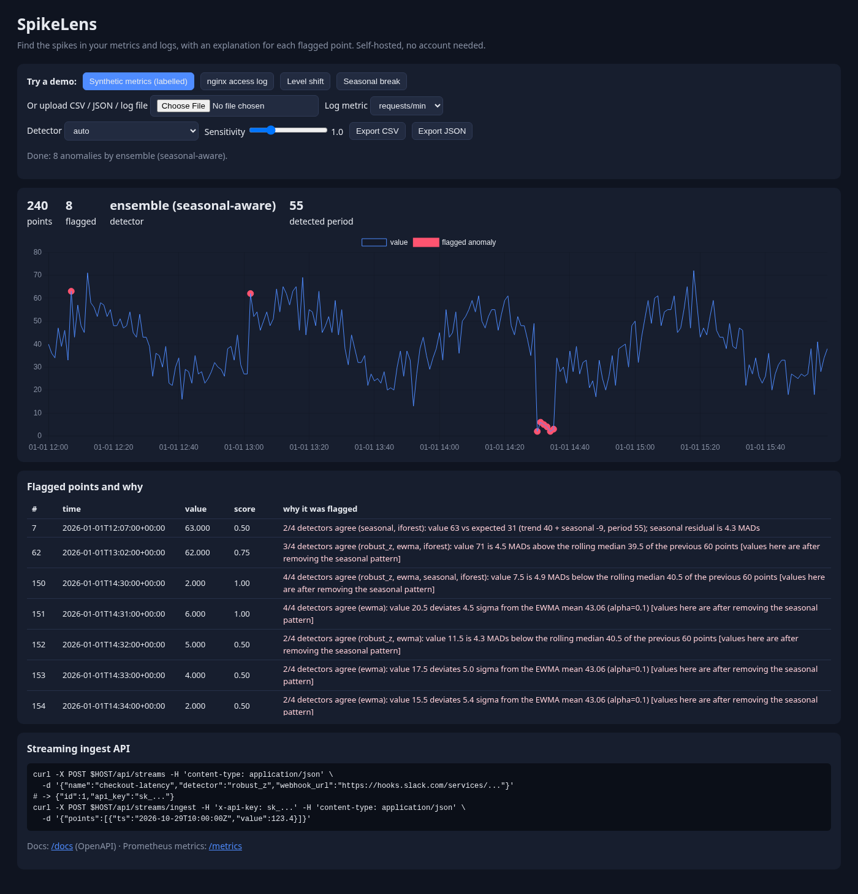
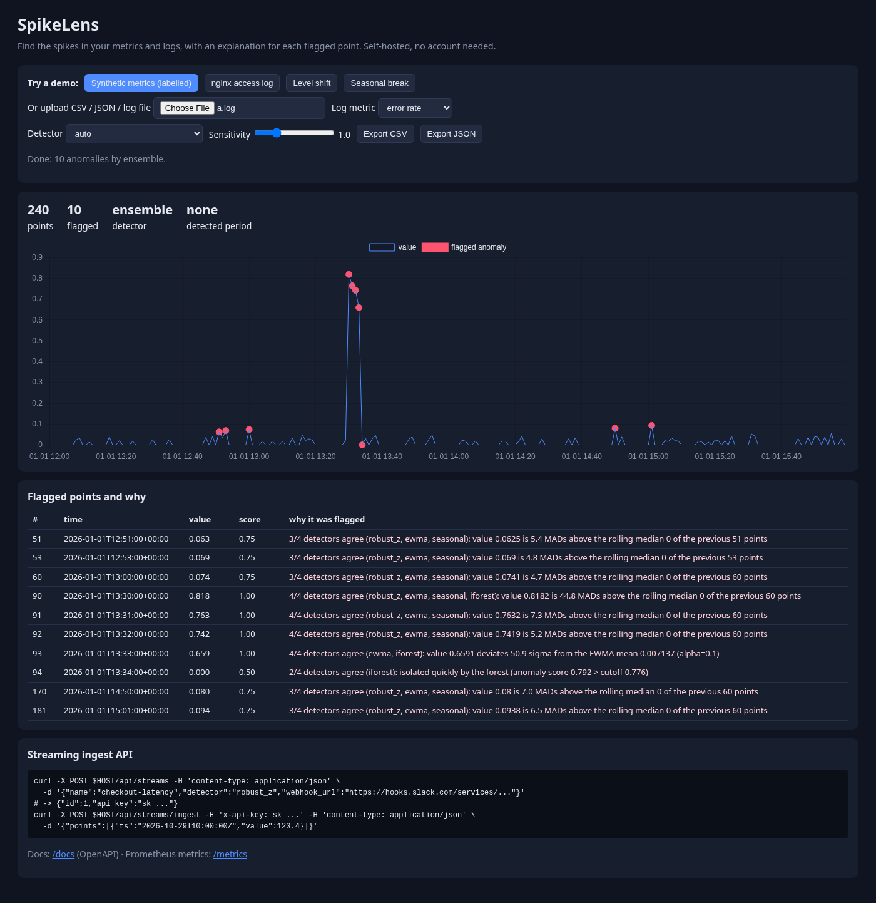
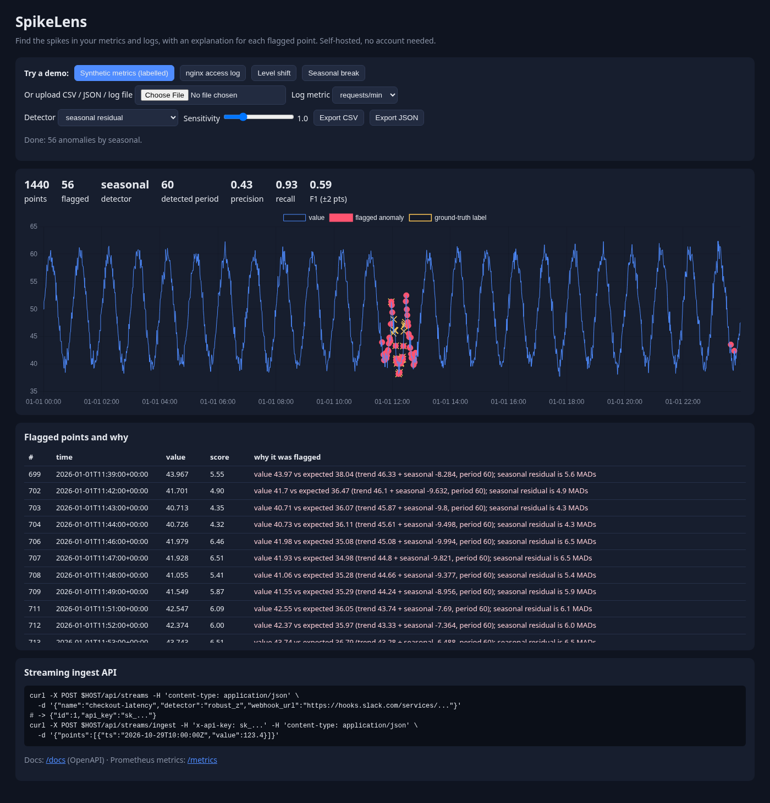

# SpikeLens

**Find the spikes in your metrics and logs, and see why each point was flagged.**
SpikeLens is a small, self-hostable anomaly-detection web app: upload a CSV/JSON time series or a raw
nginx/apache/app log (or stream points to an API with a key), and get an interactive chart with anomalies
highlighted and a plain-English reason for every flagged point, e.g.

> `3/4 detectors agree (robust_z, ewma, iforest): value 71 is 4.5 MADs above the rolling median 39.5 of the previous 60 points`
> `value 63 vs expected 31 (trend 40 + seasonal -9, period 55); seasonal residual is 4.3 MADs`

One container, one SQLite file, no account, no agents to install.



> Personal project by Sahishnu Kumar. Live demo: _not deployed yet_ (see [Deploy](#deploy)).

---

## The problem

Small teams (student projects, early startups, side projects, a single VPS running an API) still need to know
when "something looks weird": a latency spike, an error burst in the access log, traffic dropping to zero.
Their options today:

| option | what goes wrong for a small team |
|---|---|
| **Datadog / New Relic anomaly monitors** | paid per host/metric; overkill for one VPS; data leaves your machine |
| **Prometheus + Grafana + Alertmanager** | three services to run and configure; alerts are static thresholds you have to hand-tune; seasonal patterns (daily traffic cycles) cause false alarms |
| **ad-hoc pandas script / cron** | no UI, no explanation, nobody re-tunes it, no streaming |
| **Spreadsheet eyeballing** | doesn't scale past a few hundred points |

**Who it's for:** developers and students who have a CSV of metrics or a log file *right now* and want an
answer in one minute, and small services that want a cheap "is this point weird?" API plus a Slack ping.

**Why it's better for that user (honest version):** zero-config (period is auto-detected, thresholds are
robust statistics instead of hand-tuned absolute values), explainable (every flag carries its reason),
log-aware (parses raw access logs into requests/min and error-rate series), and tiny (one container, a
SQLite file). It is **not** a replacement for a full observability stack: no dashboards-as-code, no
long-term metric storage, no multi-tenant auth, no distributed tracing.

## Features

- **Inputs**: CSV (`timestamp,value[,label]` or headerless), JSON (`[..]`, `{values:[..]}`, `[{ts,value}]`),
  log files (nginx/apache combined format, generic `YYYY-MM-DD HH:MM:SS LEVEL ...` lines) -> per-minute
  request count, error count and error-rate series (gaps filled with 0 so outages show up).
- **Detectors (implemented from scratch with numpy, except Isolation Forest)**
  - rolling robust z-score: median / MAD of the previous *w* points (MAD fallback for sparse data)
  - EWMA control chart (separate smoothing for mean and variance; spikes don't poison the state)
  - seasonal residual: auto period via FFT autocorrelation (+ harmonic refinement), rolling-median trend,
    per-phase median seasonal profile, robust z on the residual
  - Isolation Forest baseline (scikit-learn) on value / first difference / local deviation
  - **seasonal-aware ensemble** (default `auto`): if a period is found, the non-seasonal detectors run on
    the deseasonalized series; a point is flagged when >= 2 of 4 agree (±1 point tolerance)
- **Dashboard**: one-click demo datasets, detector picker, sensitivity slider, ground-truth overlay and
  precision/recall/F1 when labels are provided, flagged-points table with reasons, CSV/JSON export.
- **Streaming ingest API**: `POST /api/streams` returns an API key (only its SHA-256 is stored);
  `POST /api/streams/ingest` scores points incrementally (sorted-window median/MAD, O(1) EWMA), persists them,
  and fires a **Slack-compatible webhook** (`{"text": ...}`) in a background task when anomalies occur.
  Detector state is rebuilt from SQLite after a restart.
- **Ops**: Prometheus `/metrics` (request counters, latency histograms, points ingested, anomalies found),
  OpenAPI docs at `/docs`, health check, single Docker image, upload size limit.

## Architecture





```
spikelens/
  detectors.py   batch detectors, period detection, ensemble, precision/recall
  streaming.py   RollingMedian (sorted window), StreamingRobustZ, StreamingEWMA
  logparse.py    log line parsing + per-minute bucketing
  main.py        FastAPI app (analyze, upload, export, demo, streams, /metrics)
  db.py          sqlite3 persistence    metrics.py  Prometheus text exporter
  synthetic.py   seeded synthetic series + demo nginx log
  static/        dashboard (vanilla JS + vendored Chart.js)
tests/           pytest: detectors, streaming==batch equivalence, log parser, API
eval/            accuracy evaluation (synthetic + NAB)      bench/  throughput/latency
```

More detail: [docs/DESIGN.md](docs/DESIGN.md).

## Quick start

```bash
# Docker
docker build -t spikelens . && docker run -p 7860:7860 spikelens   # open http://localhost:7860

# or locally
python -m venv .venv && . .venv/bin/activate
pip install -r requirements-dev.txt
uvicorn spikelens.main:app --reload            # http://127.0.0.1:8000
```

## API examples

```bash
# batch analysis
curl -X POST localhost:7860/api/analyze -H 'content-type: application/json' \
  -d '{"values":[10,11,10,12,11,10,48,11,10,11,12,10,11,10,9,11,10,12,11,10,10,11], "detector":"robust_z"}'

# upload a log file and analyze its error rate
curl -F file=@access.log -F log_metric=error_rate localhost:7860/api/upload

# export anomalies
curl -X POST 'localhost:7860/api/export?format=csv' -H 'content-type: application/json' -d @series.json

# streaming: create a stream (optionally with a Slack incoming-webhook URL), then push points
curl -X POST localhost:7860/api/streams -H 'content-type: application/json' \
  -d '{"name":"checkout-latency","detector":"robust_z","window":60,"webhook_url":"https://hooks.slack.com/services/XXX"}'
curl -X POST localhost:7860/api/streams/ingest -H 'x-api-key: sk_...' -H 'content-type: application/json' \
  -d '{"points":[{"ts":"2026-10-29T10:00:00Z","value":123.4}]}'
curl localhost:7860/api/streams/1 -H 'x-api-key: sk_...'
```

| env var | default | meaning |
|---|---|---|
| `PORT` | 7860 (Docker) | listen port |
| `SPIKELENS_DB` | `spikelens.db` (`/data/spikelens.db` in Docker) | SQLite path |
| `SPIKELENS_ALLOW_WEBHOOKS` | `1` | set `0` on public demos |
| `SPIKELENS_MAX_UPLOAD_MB` | `10` | upload limit |

## Results (all numbers measured by the scripts in this repo)

Reproduce with `python eval/run_eval.py` and `python bench/bench.py`. Raw output is committed in
[`eval/results.md`](eval/results.md) / [`eval/results.json`](eval/results.json) and
[`bench/results.md`](bench/results.md) / [`bench/results.json`](bench/results.json).

### Accuracy on synthetic data (10 seeds x 1440 points, ±2-point tolerance, default settings)

Series: per-minute values with hourly seasonality (amplitude 10, noise σ=1) and injected spikes (6–10σ),
a level shift (+8σ), and a half-cycle where the seasonal pattern inverts. "no seasonality" = same without
the sine wave. F1 shown; precision/recall are in `eval/results.md`.

| scenario | robust_z | ewma | seasonal | iforest | **ensemble** |
|---|---|---|---|---|---|
| spikes | 0.00 | 0.00 | 0.94 | 0.74 | **0.88** |
| level shift | 0.00 | 0.00 | 0.31 | 0.15 | **0.39** |
| seasonal break | 0.00 | 0.00 | 0.64 | 0.19 | **0.96** |
| mixed | 0.00 | 0.00 | 0.72 | 0.57 | **0.80** |
| spikes (no seasonality) | 0.95 | 0.98 | 0.95 | 0.69 | **0.95** |
| level shift (no seasonality) | 0.46 | 0.39 | 0.00 | 0.20 | **0.38** |
| mixed (no seasonality) | 0.65 | 0.59 | 0.53 | 0.77 | **0.60** |

What this shows: plain rolling z-score/EWMA are blind on seasonal data (the hourly swing is larger than the
spikes, so F1 = 0), which is exactly the false-alarm/missed-alarm problem of static thresholds. Removing the
auto-detected seasonal profile first lets the same detectors work, and the vote raises precision on
seasonal-break data (0.96 vs 0.64 for the seasonal detector alone). Level shifts are the weak spot
(precision ~0.2–0.3: detectors keep flagging for a while after the shift until the window adapts).

### Real data: NAB subset (8 labelled series from the public [Numenta Anomaly Benchmark](https://github.com/numenta/NAB))

Event-window metrics (not the official NAB score): *window recall* = share of labelled anomaly windows with
at least one flag; *flag precision* = share of flags that fall inside a window.

| detector | mean window recall | mean flag precision | mean F1 |
|---|---|---|---|
| robust_z | 0.84 | 0.31 | 0.41 |
| ewma | 0.75 | 0.34 | 0.43 |
| seasonal | 0.94 | 0.31 | 0.44 |
| iforest | 0.95 | 0.42 | **0.55** |
| ensemble | 0.94 | 0.32 | 0.44 |

Honest read: on these real series the ensemble finds 94% of incident windows but most flags fall outside
the labelled windows (precision 0.32), and the Isolation Forest baseline has the best F1. Per-file numbers
are in `eval/results.md` (e.g. `cpu_utilization_asg_misconfiguration` produces thousands of flags on a
regime change).

### Performance (8 vCPU x86_64 box, Python 3.13, single uvicorn worker, SQLite WAL)

| measurement | result |
|---|---|
| streaming robust z-score, window 60 | 223,714 points/s |
| streaming robust z-score, window 1000 | 18,297 points/s |
| streaming EWMA | 3,310,251 points/s |
| ingest API, 1 point/request (sequential client) | p50 1.42 ms, p95 2.12 ms |
| ingest API, 100 points/request | p50 2.82 ms, p95 3.65 ms (~30,000 points/s incl. SQLite writes) |
| `/api/analyze`, 1440 points, ensemble | p50 141 ms, p95 180 ms |
| batch ensemble, 10k points | 0.45 s |

### Tests

`pytest`: 44 tests covering every detector on synthetic injected anomalies, streaming-vs-batch equivalence
(the streaming detectors produce exactly the same flags as the batch ones), exact rolling median/MAD vs numpy
with duplicate-heavy data, the log parser, and the API (upload, export, auth, streams, webhook, /metrics).
CI (GitHub Actions) runs ruff, pytest on Python 3.11/3.12, the synthetic eval, and a Docker build + smoke test.

## Screenshots

| | |
|---|---|
|  synthetic labelled series, ensemble |  nginx demo log, requests/min (outage at 14:30) |
|  uploaded access.log, error-rate view (burst at 13:30) |  seasonal detector on a seasonal break |

## Design decisions & tradeoffs

- **Past-only windows** for robust z / EWMA: the batch result equals the streaming result (tested), and a
  spike cannot hide itself by inflating its own window's statistics. Cost: the first ~15 points are unscored.
- **Median/MAD instead of mean/std**: a single outlier barely moves them (50% breakdown point). MAD is 0 on
  sparse data (error rates that are mostly 0), so the scale falls back to mean absolute deviation / std and
  is floored at 0.5·std; without this, every tiny blip was a "∞-sigma" anomaly (found while testing the log demo).
- **Sorted window (bisect) instead of two heaps** for the rolling median: two heaps need lazy deletion to
  expire old points; a sorted list gives exact median *and* order statistics for MAD. Updates are O(log w)
  comparisons + an O(w) memmove, which is why window 1000 is ~12x slower than window 60. An order-statistic
  tree or skip list would make MAD O(log w) too.
- **Ensemble voting** trades a little recall for precision and covers each detector's blind spots; the
  ±1-point tolerance stops two detectors that disagree by one sample from cancelling out.
- **SQLite + one process** keeps deployment to one container. Streaming detector state lives in memory per
  process (rebuilt from the DB), so horizontal scaling would need sticky routing or shared state.
- **Vanilla JS + vendored Chart.js**: no build step, no CDN dependency at runtime.

## Limitations

- Accuracy on real data is moderate (see NAB table); false positives after level shifts and regime changes.
- Single-period seasonality only (e.g. hourly *or* daily, not both); no holiday/calendar effects.
- Streaming mode supports robust z and EWMA only (seasonal/IForest are batch only).
- API keys are per stream; there are no user accounts; the public demo disables webhooks.
- In-process state: one worker per deployment.
- Not tested with a real production workload; benchmarks are from a single machine.

## Future work

Multi-seasonality (STL with two periods), change-point detection (CUSUM / BOCPD) for level shifts, alert
de-duplication into incidents, O(log w) MAD with an order-statistic tree, Postgres backend, Grafana data-source
plugin, auth for multi-user deployments.

## Deploy

The image listens on `$PORT` (default 7860), so it runs unchanged on **Hugging Face Spaces (Docker SDK)**,
Render, Railway or Fly.io. Ready-made configs: `deploy/huggingface/` (Space README + `deploy.sh`) and
`render.yaml`. Free tiers have ephemeral disks, so streams reset on restart.

## Built with AI coding agents

This project was built with the help of AI coding agents (for scaffolding, code, tests and docs).
The problem, scope and design choices are mine; the agents helped write and iterate on the implementation.
Every number in this README was produced by running the scripts in `eval/` and `bench/` and is committed
alongside them, and the design notes include issues found while testing (e.g. the zero-MAD flood on sparse
error-rate data).

## License

MIT
